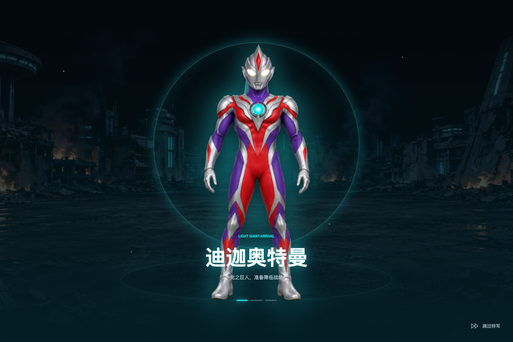
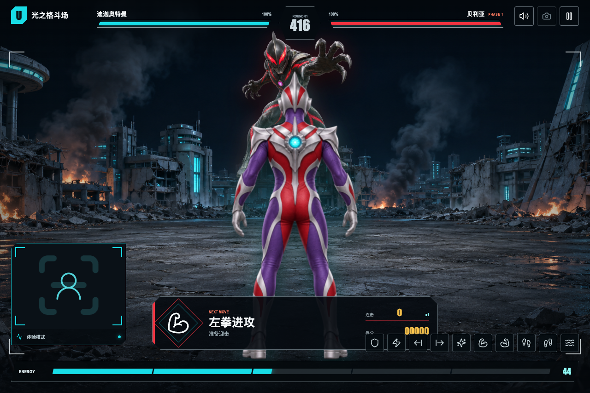

# 光之格斗场

简体中文 | [繁體中文](README.zh-TW.md)

一个基于 React、Vite 和 MediaPipe Pose Landmarker 的摄像头体感格斗原型。玩家通过身体动作控制光之巨人，在城市废墟中应对怪物攻击。

## 功能

- 摄像头姿态识别和体验模式
- 奥特曼入场、合体、英雄降临和怪物特写镜头
- 完整背身战斗视角
- 拳击、踢腿、防御、蓄能、光线和闪避动作
- 连击、能量、生命值、阶段和计分系统
- 中文语音提示和战斗音效
- 支持桌面端和移动端布局

## 本地运行

需要 Node.js 18 或更高版本。

```bash
npm install
npm run dev
```

打开终端输出的本地地址。使用“体验模式”可以在没有摄像头时体验完整战斗流程。使用“摄像头开战”需要授予浏览器摄像头权限。

## 动作控制

| 动作 | 识别方式 | 键盘或体验模式按钮 |
| --- | --- | --- |
| 一字防御 | 双臂向两侧伸直 | `X` |
| 左拳进攻 | 左拳抬高并快速挥出 | `J` |
| 右拳进攻 | 右拳抬高并快速挥出 | `K` |
| 左腿踢 | 抬起左腿并向左侧踢出 | `U` |
| 右腿踢 | 抬起右腿并向右侧踢出 | `I` |
| 汇聚能量 | 双手举过肩膀 | `C` |
| 哉佩利敖光线 | 摆出经典 L 型手势 | 空格 |
| 向左闪避 | 身体快速向左移动 | 左方向键 |
| 向右闪避 | 身体快速向右移动 | 右方向键 |
| 双手连挥 | 双手快速挥动 | `W` |

## 检查

```bash
npm run typecheck
npm run build
```

## 项目结构

- `src/` 包含 React 页面、战斗状态、姿态识别和动画逻辑
- `public/assets/` 包含本地图片、音频和姿态识别运行时资源
- `public/vision/` 包含 MediaPipe Vision WASM 和姿态模型文件

## 界面效果

### 奥特曼入场特写



### 城市废墟战斗视角



## 素材说明

仓库中的角色、背景、音效和模型文件用于本地演示。基于这些素材进行再分发或商业使用前，请确认相应素材的授权范围。

## 许可证

本项目使用 MIT License。第三方依赖和模型资源分别遵循其上游许可证。
