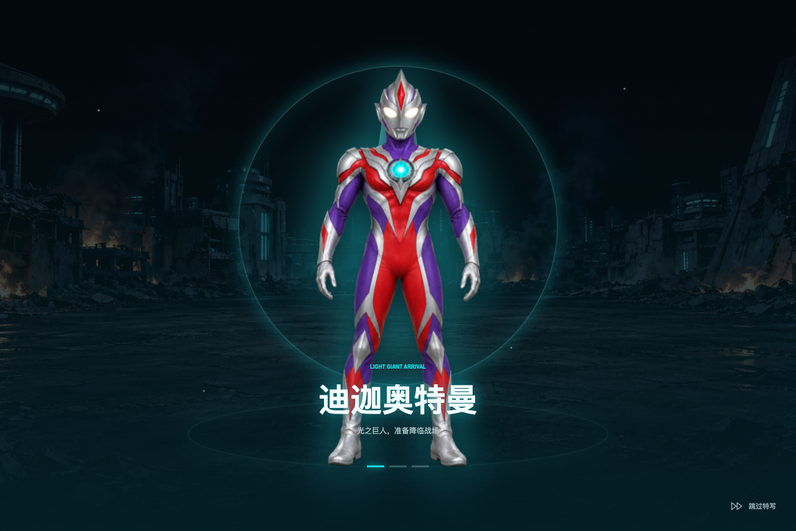
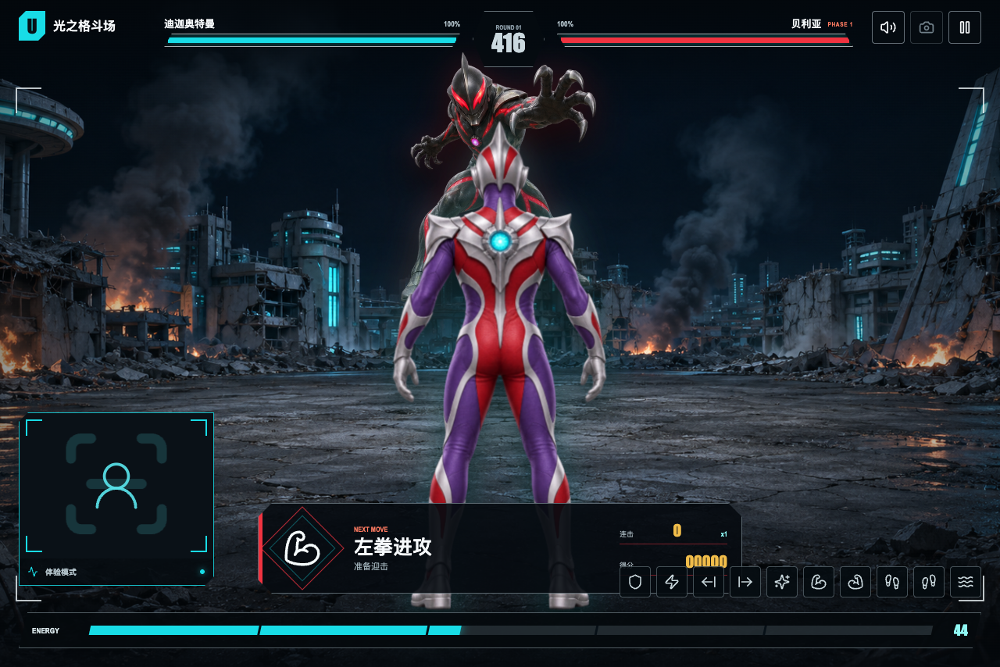

# 光之格鬥場

[简体中文](README.md) | 繁體中文

這是一個以 React、Vite 和 MediaPipe Pose Landmarker 建立的攝影機體感格鬥原型。玩家透過身體動作控制光之巨人，在城市廢墟中應對怪獸攻擊。

## 功能

- 攝影機姿態辨識和體驗模式
- 奧特曼入場、合體、英雄降臨和怪獸特寫鏡頭
- 完整背身戰鬥視角
- 拳擊、踢腿、防禦、蓄能、光線和閃避動作
- 連擊、能量、生命值、階段和計分系統
- 中文語音提示和戰鬥音效
- 支援桌面端和行動端版面

## 本地執行

需要 Node.js 18 或更新版本。

```bash
npm install
npm run dev
```

開啟終端機輸出的本地網址。使用「體驗模式」可以在沒有攝影機時體驗完整戰鬥流程。使用「攝影機開戰」需要授予瀏覽器攝影機權限。

## 動作控制

| 動作 | 辨識方式 | 鍵盤或體驗模式按鈕 |
| --- | --- | --- |
| 一字防禦 | 雙臂向兩側伸直 | `X` |
| 左拳進攻 | 左拳抬高並快速揮出 | `J` |
| 右拳進攻 | 右拳抬高並快速揮出 | `K` |
| 左腿踢 | 抬起左腿並向左側踢出 | `U` |
| 右腿踢 | 抬起右腿並向右側踢出 | `I` |
| 匯聚能量 | 雙手舉過肩膀 | `C` |
| 哉佩利敖光線 | 擺出經典 L 型手勢 | 空白鍵 |
| 向左閃避 | 身體快速向左移動 | 左方向鍵 |
| 向右閃避 | 身體快速向右移動 | 右方向鍵 |
| 雙手連揮 | 雙手快速揮動 | `W` |

## 檢查

```bash
npm run typecheck
npm run build
```

## 專案結構

- `src/` 包含 React 頁面、戰鬥狀態、姿態辨識和動畫邏輯
- `public/assets/` 包含本地圖片、音訊和姿態辨識執行時資源
- `public/vision/` 包含 MediaPipe Vision WASM 和姿態模型檔案

## 介面效果

### 奧特曼入場特寫



### 城市廢墟戰鬥視角



## 素材說明

倉庫中的角色、背景、音效和模型檔案用於本地演示。基於這些素材進行再分發或商業使用前，請確認相應素材的授權範圍。

## 授權條款

本專案使用 MIT License。第三方依賴和模型資源分別遵循其上游授權條款。
